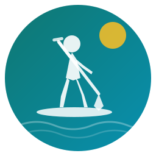
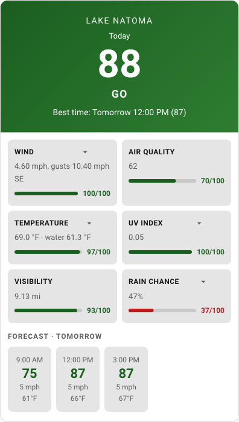
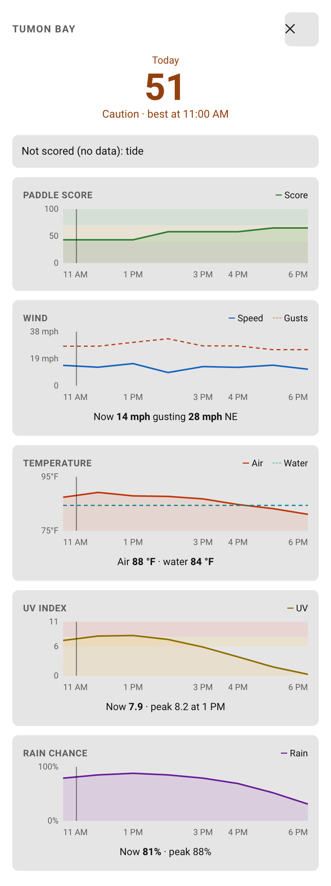
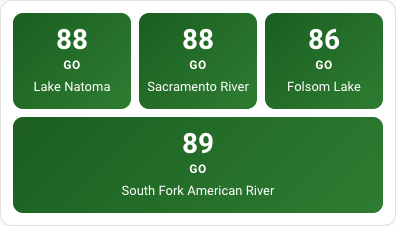
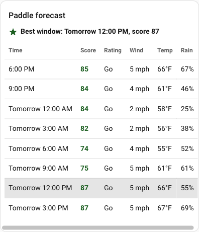
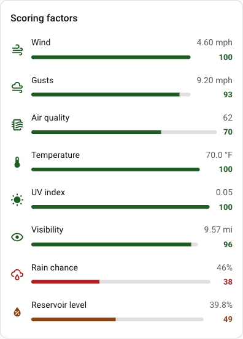

#  Paddle Conditions

[](https://opensource.org/licenses/MIT)
[](https://hacs.xyz)
[](https://www.home-assistant.io/)

Paddle Conditions scores each of your paddle spots from 0 to 100 and calls it Go, Caution or No-go, then finds the best three-hour window in the next day. It's a [Home Assistant](https://www.home-assistant.io/) integration that reads wind, air quality, temperature, UV, visibility, rain and water data from free public sources, so there is nothing to sign up for.

<p align="center">
  
  &nbsp;&nbsp;
  
</p>

I built this because I was tired of checking four different apps before every paddle. Wind on one site, AQI on another, water temp somewhere else, streamflow on a USGS page that looks like it was designed in 1998. I paddle year-round on spots like [Lake Natoma](https://www.mklibrary.com/lake-natoma-california/), [Sand Harbor at Tahoe](https://www.mklibrary.com/sand-harbor-state-park-paddle-boarding/), and [New Bullards Bar Reservoir](https://www.mklibrary.com/new-bullards-bar-reservoir-california/), and I do [distance sessions](https://www.mklibrary.com/why-you-bonk-on-long-paddle-board-sessions/) where conditions at launch can be completely different from conditions at mile 5. I needed one place that pulled it all together and told me: should I go, or not?

The score is computed exactly as the [Paddle Conditions app](https://paddleconditions.com/) computes it, so a spot shows one number in both. Add as many locations as you like. Start typing a lake or river and, if it's one of our curated spots, the coordinates and gauges fill themselves in.

---

## Table of contents

- [Installation](#installation)
- [Adding locations](#adding-locations)
- [How the score works](#how-the-score-works)
- [Dashboard cards](#dashboard-cards)
- [Entities](#entities)
- [Data sources](#data-sources)
- [Automation example](#automation-example)
- [Known limitations](#known-limitations)
- [Removing the integration](#removing-the-integration)
- [Troubleshooting](#troubleshooting)
- [Contributing](#contributing)
- [License](#license)

---

## Installation

Paddle Conditions is in the HACS default store. From Home Assistant 2026.11, HACS is built in as **Settings > Marketplace**.

1. Open HACS (or Marketplace) in Home Assistant
2. Search for "Paddle Conditions" and install it
3. Restart Home Assistant

It needs Home Assistant 2026.9 or later.

<details>
<summary>Manual installation</summary>

Copy `custom_components/paddle_conditions/` to your Home Assistant `custom_components/` directory and restart.

</details>

---

## Adding locations

1. Go to **Settings > Devices & Services > Add Integration**, search for "Paddle Conditions" and confirm
2. Open the integration and choose **Add paddle location**
3. Start typing to search the curated spots, or choose **Custom location**

A curated spot comes with its coordinates, water body type and stations already filled in. For California spots that includes the CDEC gauges, the reservoir's capacity and a dam-release limit. You can change any field before saving. If the Paddle Conditions spot list can't be reached, you'll see the built-in presets instead: Lake Natoma, Lake Clementine, Sand Harbor at Lake Tahoe and New Bullards Bar Reservoir.

| Field | Required | What to enter |
|-------|----------|---------------|
| Location name | Yes | Whatever you call it, e.g. "Lake Union" or "Deschutes River" |
| Latitude, longitude | Yes | Decimal degrees. Right-click a spot in Google Maps to copy them. |
| Water body type | Yes | Lake, River, or Bay/Ocean. Decides which water factors apply. |
| USGS station ID | No | Water temperature and river flow. Find one at [waterdata.usgs.gov](https://waterdata.usgs.gov). |
| NOAA station ID | No | Water temperature on bays and the coast. Find one at [tidesandcurrents.noaa.gov](https://tidesandcurrents.noaa.gov). |
| Optimal streamflow | No | The river flow you like, in CFS. Rivers only. |
| CDEC station IDs | No | California only. Comma-separated, nearest first, e.g. `FOL, AFO`. Find them at [cdec.water.ca.gov](https://cdec.water.ca.gov). |
| Reservoir capacity | No | Full capacity in acre-feet, for the reservoir level factor |
| Dam release limit | No | Dam outflow in CFS above which the spot is a No-go |

Leave an optional number empty to turn its factor off. To change a location later, open its three-dot menu under **Settings > Devices & Services > Paddle Conditions** and choose **Reconfigure**; the integration reloads when you save.

### Options

Under the integration's **Configure**:

| Option | Default | What it does |
|--------|---------|--------------|
| Activity | Paddle boarding | SUP or kayaking |
| Profile | Recreational | Curves, weights and No-go limits for how you paddle |
| Update interval | 10 min | How often to refresh, from 5 to 60 minutes |
| Factor weights | From the profile | Sliders for the seven weather factors, normalized to 100%. Water factor weights come from the profile. |
| USGS API key | None | A free key from [api.waterdata.usgs.gov](https://api.waterdata.usgs.gov/signup/) refreshes river data every 15 to 20 minutes instead of hourly |

---

## How the score works

Each factor gets its own 0 to 100 score on a curve set by your profile, and the weighted average is the paddle score. 70 and up is Go, 40 to 69 Caution, below 40 No-go. Recreational SUP weights:

| Factor | Weight | Measured as |
|--------|--------|-------------|
| Wind speed | 30% | Sustained wind |
| Air quality | 20% | US AQI |
| Temperature | 15% | Air temperature against your profile's comfort range |
| Wind gusts | 10% | Gust speed |
| UV index | 10% | UV index |
| Visibility | 10% | Distance, which drops in fog, haze and smoke |
| Rain chance | 5% | Probability of precipitation |

Water factors count when the location has the data. Rivers add streamflow against your optimal flow. California spots with CDEC gauges add reservoir level (100 at 60% full, 0 at 20%), river stage measured against that gauge's history for the month, and water quality from turbidity, dissolved oxygen, pH and conductivity. A factor with no data drops out and the rest are reweighted.

Some conditions make a spot a No-go whatever the score says: a thunderstorm, sustained wind or gusts over your profile's limit, air quality over its limit, visibility under it, air temperature below it, dam outflow above your dam-release limit, or a river at or above its 95th percentile for the month. The `paddle_score` sensor's `veto_reason` attribute says which one.

There are three paddle boarding profiles (Recreational, Racing, Family) and three for kayaking (Flatwater, River, Ocean). Racing and River tolerate more wind, and Family wants less wind, warmer air and cleaner air before it says Go. Racing SUP and river kayaking also score higher river levels as better, where the other profiles prefer lower water.

---

## Dashboard cards

Six cards come with the integration, so there's nothing else to download from HACS. Pick a Paddle Score sensor in the card picker and the Paddle cards are suggested. Each card finds the location's other sensors on its own, even if you've renamed them, and follows your units, language, time zone and theme.

| Card | What you see |
|------|--------------|
| `paddle-score-card` | One spot: the score, the best time to go, a tile per factor (tap one for its hourly forecast) and the next few 3-hour blocks. Tap the score for hourly charts from sunrise to sunset. |
| `paddle-spots-card` | Every spot's score and rating side by side. Tap one for its details. |
| `paddle-factors-card` | Each factor's reading and sub-score, including river stage, reservoir level and water quality when they count. Tap a row for that sensor's history. |
| `paddle-forecast-card` | The next 24 hours in 3-hour blocks, with the best window starred |
| `paddle-chart-card` | The score over the next 24 hours, with optional wind, temperature, UV and rain layers |
| `paddle-history-card` | Score history over 7, 30 or 90 days, with the average, the best score and the number of Go days |

<p align="center">
  
  &nbsp;
  
  &nbsp;
  
</p>

The best time to go uses the spot's own sunrise and sunset and ends at least two hours before dark.

To build a whole dashboard at once, run the `paddle_conditions.get_dashboard_yaml` action from **Developer Tools > Actions**, copy the response, and paste it into a new dashboard's **Raw configuration editor** (**Settings > Dashboards > Add Dashboard > From scratch**, then the three-dot menu > **Edit Dashboard** > three-dot menu). Run it again after adding or removing locations.

### Accessibility

The cards meet WCAG 2.2 AA, checked with axe-core in light and dark mode. Every control is a real button, so keyboards and switch access work. The details view is a proper modal: focus moves in, stays in, and returns when it closes, and Escape closes it. Each chart has a spoken summary and its hourly values as a table for screen readers. The history card announces when its data loads or fails. Every rating color has at least 4.5:1 contrast on its background and the rating is always written out as well. Animations stop when you've asked for reduced motion.

---

## Entities

Each location gets 21 sensors. The four water quality sensors start disabled. River stage, reservoir level and dam outflow are turned on for locations with CDEC stations, and streamflow for locations with a USGS or CDEC station.

| Entity | Unit | Description |
|--------|------|-------------|
| `paddle_score` | % | Overall score, 0 to 100 |
| `rating` | | `go`, `caution` or `no_go`, for automations |
| `wind_speed` | mph | Sustained wind |
| `wind_gusts` | mph | Wind gusts |
| `wind_direction` | ° | Wind bearing (long-term statistics average the angle correctly) |
| `air_temp` | °F | Air temperature |
| `water_temp` | °F | Water temperature, from CDEC, then USGS, then NOAA |
| `uv_index` | | UV index |
| `aqi` | AQI | US Air Quality Index |
| `visibility` | mi | Visibility |
| `precipitation` | % | Chance of rain |
| `streamflow` | CFS | River flow, from a CDEC or USGS station |
| `river_stage` | ft | River height at the CDEC gauge |
| `reservoir_level` | % | How full the reservoir is, with `storage_acre_feet` as an attribute |
| `dam_outflow` | CFS | Water released from the dam |
| `turbidity` | NTU | Water clarity |
| `dissolved_oxygen` | mg/L | Dissolved oxygen |
| `ph` | | pH |
| `conductivity` | µS/cm | Conductivity |
| `condition` | | Current conditions, as keys like `partly_cloudy` or `thunderstorm`, shown translated |
| `forecast_3hr` | | The score of the next 3-hour block, with the whole forecast in its attributes |

Units follow your Home Assistant unit system.

**`paddle_score` attributes:** `rating`, `activity`, `profile`, `limiting_factor` (the factor pulling the score down most), `factors` (each factor's score), `missing_factors`, `vetoed` and `veto_reason`.

**`forecast_3hr` attributes:** up to eight 3-hour blocks starting at the current hour, each with its score, rating, wind, gusts, temperature, UV, rain chance, air quality and visibility; `best_block` and `best_score`; and 48 hours of hourly arrays (`hourly_times`, `hourly_wind`, `hourly_gusts`, `hourly_temp`, `hourly_uv`, `hourly_precip`). Times are ISO 8601 in UTC with an offset, and the cards show them in your time zone. These attributes aren't written to the recorder, so they don't grow your database.

---

## Data sources

Every source is free and public. Only USGS offers a key, and it's optional.

| Source | What it supplies | Used for |
|--------|------------------|----------|
| [Open-Meteo](https://open-meteo.com/) | Weather (wind, gusts, temperature, UV, visibility, rain, conditions, 48-hour forecast) and air quality | Every location |
| [National Weather Service](https://www.weather.gov/documentation/services-web-api) | Wind, gusts, wind direction, temperature and rain chance, now and hourly, read hourly | US locations, automatically |
| [USGS Water Data API](https://api.waterdata.usgs.gov/) | Water temperature and river flow, read hourly (every 15 to 20 minutes with a key) | Locations with a USGS station |
| [NOAA CO-OPS](https://tidesandcurrents.noaa.gov/) | Water temperature | Locations with a NOAA station |
| [CDEC](https://cdec.water.ca.gov/) | Reservoir storage and dam outflow, river stage, flow, water temperature and water quality, read every 30 minutes | California locations with CDEC stations |
| [Paddle Conditions](https://paddleconditions.com/) | The curated spot list, each spot's gauges, capacity and dam-release limit, and its monthly river-stage history | Curated spots |

In the US, the National Weather Service supplies wind, gusts, direction, temperature and rain chance, because its forecasts handle big lakes better than Open-Meteo's global model. Open-Meteo still provides UV, visibility and conditions, and takes over completely when NWS is down or its forecast is more than three hours old. CDEC water temperature and flow take precedence over USGS, as they do in the app.

Water readings older than six hours are dropped, so a dead gauge stops counting. With several CDEC stations, each value comes from the nearest one that reported it recently. If a water source fails, its factors drop out and the score carries on without them.

The last good conditions for each location are saved to disk, so after a restart your dashboard shows a recent reading before the first refresh finishes. If the weather service goes down, the last reading stays up for an hour (or two update intervals, if that's longer), then the sensors go unavailable rather than show an old Go as if it were current. Each outage is logged once, and again when the source comes back.

---

## Automation example

A phone notification when your spot turns Go on a weekend morning:

```yaml
automation:
  - alias: "Lake Natoma is a go"
    triggers:
      - trigger: state
        entity_id: sensor.lake_natoma_rating
        to: "go"
    conditions:
      - condition: time
        after: "06:00:00"
        before: "11:00:00"
        weekday: [sat, sun]
    actions:
      - action: notify.mobile_app_your_phone
        data:
          title: "Lake Natoma is a go"
          message: >-
            Score {{ states('sensor.lake_natoma_paddle_score') }},
            wind {{ states('sensor.lake_natoma_wind_speed') }} mph.
```

---

## Known limitations

- **Tides aren't scored yet.** Bay and ocean locations score without a tide factor.
- **USGS without a key refreshes hourly.** Keyless requests share a small per-network quota. A free key under **Configure** brings it to every 15 to 20 minutes.
- **Water data is US-only.** USGS and NOAA cover the United States, CDEC covers California, and NWS the contiguous US. Weather and air quality work anywhere Open-Meteo does.
- **River stage needs a curated spot.** Its monthly history comes from Paddle Conditions, so a custom location with CDEC stations gets reservoir level, water quality and the dam-release No-go, but not river stage.

---

## Removing the integration

1. Go to **Settings > Devices & Services > Paddle Conditions**
2. Open the three-dot menu and choose **Delete**. That removes every location, its entities and its cached conditions.
3. Optionally uninstall it from HACS and restart Home Assistant
4. Take the Paddle Conditions cards off any dashboards that used them

---

## Troubleshooting

### No data after setup
- Check the coordinates: latitude between -90 and 90, longitude between -180 and 180.
- Look in **Settings > System > Logs** for `paddle_conditions` errors.
- If Open-Meteo is down, the integration keeps retrying.

### Water temperature or streamflow missing
- These need a USGS, NOAA or CDEC station on the location.
- Check the station at [waterdata.usgs.gov](https://waterdata.usgs.gov), [tidesandcurrents.noaa.gov](https://tidesandcurrents.noaa.gov) or [cdec.water.ca.gov](https://cdec.water.ca.gov). Not every station reports every reading.

### "Could not load this spot from Paddle Conditions"
- The spot list loaded but that spot's details didn't. Try again, or choose **Custom location** and enter it yourself.

### "USGS is rate limiting river data" repair
- USGS limits keyless requests per network. Get a free key at [api.waterdata.usgs.gov/signup](https://api.waterdata.usgs.gov/signup/) and add it under **Configure > USGS API key**. The repair clears itself once USGS answers again.

### The score looks wrong
- `limiting_factor` on the `paddle_score` sensor names the factor pulling it down, and `veto_reason` explains a No-go.
- Check your profile and weights under **Configure**. Recreational may be stricter or looser than how you paddle.

### Cards missing or out of date
- The cards register when the integration loads. If they're not in the card picker, restart Home Assistant.
- After an update the card URL changes, so browsers fetch the new version. If you still see the old cards, reload the page. In the companion app, use **Settings > Companion app > Debugging > Reset frontend cache**.
- Check the browser console (F12) for JavaScript errors.

### "Configuration error" on a card after a restart
- Home Assistant was too busy to serve the card file while the data sources were timing out. Restart it once. After the first successful refresh, the saved conditions load straight away on later restarts.

---

## Contributing

[CONTRIBUTING.md](https://github.com/FrogStoneMedia/paddle-conditions/blob/main/CONTRIBUTING.md) covers setup, tests and how to send a change. In short: Python 3.14, `pip install -r requirements_test.txt`, write the failing test first, run `pytest tests/`, lint with `ruff check . && ruff format .`, and use [Conventional Commits](https://www.conventionalcommits.org/) (`fix(scoring): ...`).

---

## License

MIT. See [LICENSE](https://github.com/FrogStoneMedia/paddle-conditions/blob/main/LICENSE).
