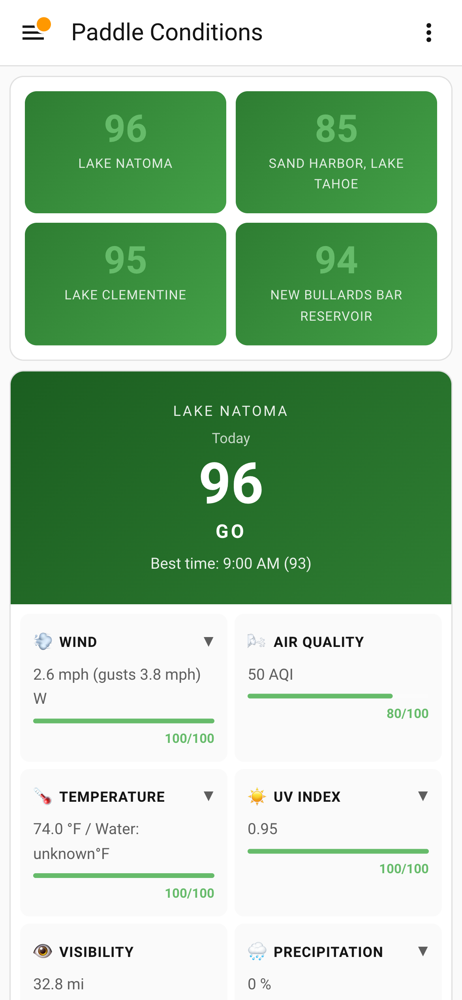
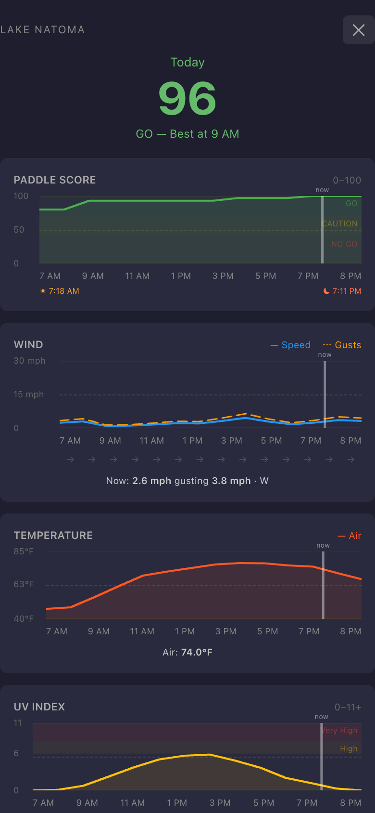
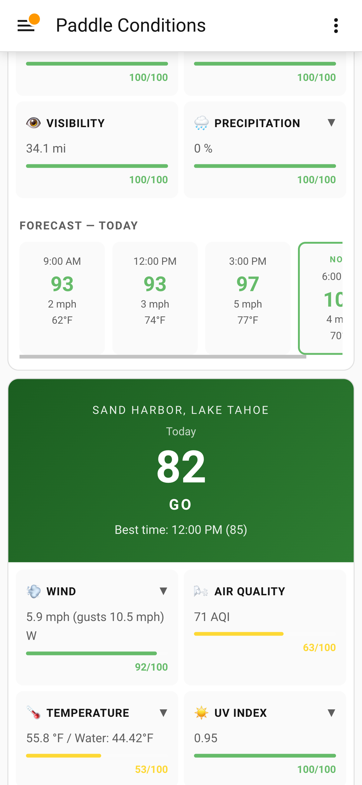
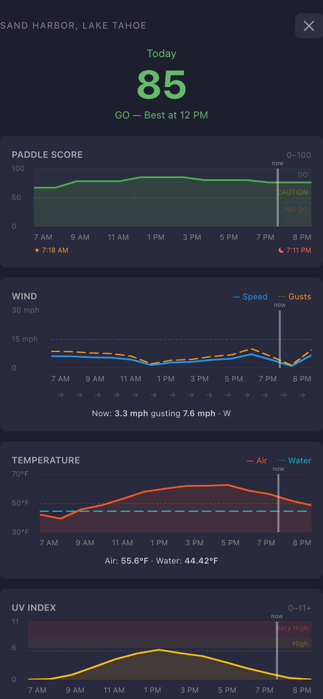

#  Paddle Conditions

[](https://opensource.org/licenses/MIT)
[](https://hacs.xyz)
[](https://www.home-assistant.io/)

Paddle Conditions is a [Home Assistant](https://www.home-assistant.io/) custom integration that fetches weather, water, and air quality data for your paddle spots, scores each one **Go / Caution / No-go**, and shows a 24-hour forecast so you can pick the best window. All data comes from free public APIs. No accounts, no subscriptions, and no API keys required.

<p align="center">
  
  &nbsp;&nbsp;
  
</p>

I built this because I was tired of checking four different apps before every paddle. Wind on one site, AQI on another, water temp somewhere else, streamflow on a USGS page that looks like it was designed in 1998. I paddle year-round on spots like [Lake Natoma](https://www.mklibrary.com/lake-natoma-california/), [Sand Harbor at Tahoe](https://www.mklibrary.com/sand-harbor-state-park-paddle-boarding/), and [New Bullards Bar Reservoir](https://www.mklibrary.com/new-bullards-bar-reservoir-california/), and I do [distance sessions](https://www.mklibrary.com/why-you-bonk-on-long-paddle-board-sessions/) where conditions at launch can be completely different from conditions at mile 5. I needed one place that pulled it all together and told me: should I go, or not?

---

## Table of contents

- [Features](#features)
- [Installation](#installation)
- [Configuration](#configuration)
- [Entities](#entities)
- [Scoring](#scoring)
- [Dashboard](#dashboard)
- [Data sources](#data-sources)
- [Automation example](#automation-example)
- [Known limitations](#known-limitations)
- [Removing the integration](#removing-the-integration)
- [Troubleshooting](#troubleshooting)
- [Contributing](#contributing)
- [License](#license)

---

## Features

### Paddle score
- **Go / Caution / No-go rating** for any paddle location
- **7 weighted factors**: wind speed, wind gusts, AQI, temperature, UV index, visibility, precipitation
- **Water factors where the data exists**: streamflow for rivers, plus reservoir level, river stage and water quality from California's CDEC gauges
- **Hard vetoes** block automatically for thunderstorms, extreme wind, a high dam release, or a river running dangerously high
- **Same score as the Paddle Conditions app**: same curves, weights, vetoes and rounding
- **24-hour forecast** in eight 3-hour blocks with a "best window" pick

### Profiles
- **Paddle boarding**: Recreational, Racing, Family
- **Kayaking**: Flatwater, River, Ocean
- Each profile has its own scoring curves, weights, and veto thresholds
- Weights are customizable in the options UI

### Multiple locations
- Add as many paddle locations as you want (each is a subentry)
- Each location gets its own sensors and update cycle
- Supports lakes, rivers, and bays/oceans with the right data sources for each
- **Search the Paddle Conditions spots** when you add one and the coordinates and gauges fill themselves in

### California reservoirs and rivers
Add CDEC station IDs to a California location and the score picks up the same factors the app uses:
- **Reservoir level**: 100 at 60% full or more, 0 at 20% or less (needs the reservoir's capacity)
- **River stage**: compared with that gauge's history for the month (curated spots, since the history comes from Paddle Conditions). Racing SUP and river kayaking score higher water better; everyone else scores lower water better.
- **Water quality**: turbidity, dissolved oxygen, pH and conductivity, from whichever the station reports
- **No-go** when dam outflow passes your dam-release limit, or the river is above its 95th percentile for the month

### Bundled dashboard cards
Six Lovelace cards ship with the integration in one bundle. No extra HACS card downloads needed. They show up in the card picker (and are suggested when you pick a Paddle Score sensor), have visual editors, size themselves in the sections view, and follow your units, language, time zone and light or dark theme.
- **`paddle-score-card`**: all-in-one card with hero score, Go/Caution/No-go rating, best time to paddle, factor grid with tap-to-expand hourly forecasts, a 3-hour forecast strip, and a details view with hourly charts
- **`paddle-spots-card`**: every spot's score and rating at a glance
- **`paddle-factors-card`**, **`paddle-forecast-card`**, **`paddle-chart-card`**, **`paddle-history-card`**: the factor breakdown, a forecast table, a layered 24-hour chart, and score history from the recorder

<p align="center">
  
  &nbsp;&nbsp;
  
</p>

### Accessibility
The cards are built to WCAG 2.2 AA and checked with axe-core in light and dark mode:
- **Real buttons** everywhere, so keyboard and switch access work without extra handling
- **A proper modal** for the details view: focus moves into it, stays there, and returns when it closes; Escape always closes it
- **Text alternatives for every chart**: a spoken summary plus the hourly values as a table for screen readers
- **Status announcements** when history loads or fails
- **Contrast of at least 4.5:1** for every rating colour on every surface, and the rating is always also written out
- **Respects `prefers-reduced-motion`**, including chart animations
- **Color contrast** meets AA ratios. Ratings include text labels alongside color so no information is conveyed by color alone.

### Caching and freshness
The last good conditions for each location are cached to disk. On restart, a recent cached reading loads immediately so your dashboard renders before APIs respond. If the weather API fails, the last reading stays up for up to an hour (or two update intervals, if that's longer). After that the sensors go unavailable, so you never see an old Go as if it were current. Each outage is logged once, and again when the source comes back.

---

## Installation

### HACS (recommended)

Paddle Conditions is in the HACS default store. On Home Assistant 2026.11 and later, HACS is built in as **Settings > Marketplace**.

1. Open HACS (or Marketplace) in Home Assistant
2. Search for "Paddle Conditions" and install it
3. Restart Home Assistant

Requires Home Assistant 2026.9 or later.

<details>
<summary>Manual installation</summary>

Copy `custom_components/paddle_conditions/` to your Home Assistant `custom_components/` directory and restart.

</details>

---

## Configuration

### Adding the integration

1. Go to **Settings > Devices & Services > Add Integration**
2. Search for "Paddle Conditions" and confirm setup
3. Click the integration card, then **Add Entry** to add your first paddle location

### Adding a location

Start typing to search the curated Paddle Conditions spots. Picking one fills in its coordinates, water body type, USGS and NOAA stations, and for California spots the CDEC stations, reservoir capacity and dam-release limit. Every field stays editable. Or choose "Custom location" to enter everything yourself. If Paddle Conditions can't be reached, the built-in presets (Lake Natoma, Lake Clementine, Sand Harbor at Lake Tahoe, and New Bullards Bar Reservoir) are offered instead.

For each location you need:

| Field | Required | Description |
|-------|----------|-------------|
| Location name | Yes | A friendly name, e.g. "Lake Union" or "Deschutes River" |
| Latitude | Yes | Decimal degrees (right-click on Google Maps to copy) |
| Longitude | Yes | Decimal degrees |
| Water body type | Yes | Lake, River, or Bay/Ocean. Controls which data sources and scoring factors apply. |
| USGS station ID | No | For water temperature and river streamflow. Find yours at [waterdata.usgs.gov](https://waterdata.usgs.gov) |
| NOAA station ID | No | For water temperature and tides. Find yours at [tidesandcurrents.noaa.gov](https://tidesandcurrents.noaa.gov) |
| Optimal streamflow | No | Preferred river flow in CFS (river locations only) |
| CDEC station IDs | No | California only. Comma-separated, nearest first, e.g. `FOL, AFO`. Find them at [cdec.water.ca.gov](https://cdec.water.ca.gov) |
| Reservoir capacity | No | Full capacity in acre-feet, for scoring reservoir level |
| Dam release limit | No | Dam outflow (CFS) above which the spot is a No-go |

Optional number fields can be cleared when you edit a location; an empty field turns that factor off.

### Editing a location

To change a location's settings (e.g. adding a USGS station ID for water temperature):

1. Go to **Settings > Devices & Services > Paddle Conditions**
2. Click the three-dot menu next to the location you want to edit
3. Select **Reconfigure**
4. Update any fields and submit. The integration reloads automatically

### Options

Access via the integration card > **Configure**:

| Option | Default | Description |
|--------|---------|-------------|
| Activity | Paddle Boarding | SUP or kayaking, each with its own profiles |
| Profile | Recreational | Preset weight config for your paddling style |
| Update interval | 10 min | How often to refresh data (5 to 60 minutes) |
| Factor weights | Profile defaults | Adjust individual scoring weights (auto-normalized to 100%). Streamflow, tide, reservoir level, river stage and water quality weights come from the profile. |
| USGS API key | None | Optional, free from [api.waterdata.usgs.gov](https://api.waterdata.usgs.gov/signup/). Lets river data refresh every 15 to 20 minutes instead of hourly. |

---

## Entities

Each location creates 21 sensors. The four water quality sensors start disabled; the CDEC sensors are enabled for locations with CDEC stations.

| Entity | Unit | Description |
|--------|------|-------------|
| `paddle_score` | % | Overall score (0 to 100) with Go/Caution/No-go rating |
| `rating` | | Go, Caution, or No-go, as its own sensor for automations |
| `wind_speed` | mph | Current wind speed |
| `wind_gusts` | mph | Peak wind gusts |
| `wind_direction` | ° | Wind bearing in degrees (statistics average angles correctly) |
| `air_temp` | °F | Air temperature |
| `water_temp` | °F | Water temperature (CDEC, then USGS, then NOAA) |
| `uv_index` | | UV radiation index |
| `aqi` | AQI | US Air Quality Index |
| `visibility` | mi | Atmospheric visibility |
| `precipitation` | % | Precipitation probability |
| `streamflow` | CFS | River flow rate (CDEC or USGS station; enabled for locations that have one) |
| `river_stage` | ft | River height at the CDEC gauge |
| `reservoir_level` | % | How full the reservoir is, with `storage_acre_feet` as an attribute (needs capacity) |
| `dam_outflow` | CFS | Water released from the dam (needs a dam-release limit) |
| `turbidity` | NTU | Water clarity (disabled by default) |
| `dissolved_oxygen` | mg/L | Dissolved oxygen (disabled by default) |
| `ph` | | pH (disabled by default) |
| `conductivity` | µS/cm | Conductivity (disabled by default) |
| `condition` | | Weather conditions, translated (state values are keys like `partly_cloudy` or `thunderstorm`) |
| `forecast_3hr` | | 3-hour forecast blocks with per-block scores and hourly data |

### Paddle score attributes

The `paddle_score` sensor exposes these attributes:

- `rating`: GO, CAUTION, or NO_GO
- `activity`: current activity (sup or kayaking)
- `profile`: active scoring profile
- `limiting_factor`: the condition hurting your score the most
- `factors`: individual scores for each weather factor
- `veto`: whether a hard veto is active (e.g. thunderstorm)

### Forecast attributes

The `forecast_3hr` sensor provides:
- Up to 8 forecast blocks (24 hours), starting at the current hour
- Each block has score, rating, wind, gusts, temperature, UV, precipitation, start/end times
- `best_block` and `best_score` answer "when should I go?"
- Hourly arrays (`hourly_times`, `hourly_wind`, `hourly_gusts`, `hourly_temp`, `hourly_uv`, `hourly_precip`) for 48 hours of per-hour data
- All times are ISO 8601 in UTC with an explicit offset; Home Assistant and the cards show them in your local time
- These attributes are left out of the recorder database

---

## Scoring

Seven factors are scored individually using piecewise linear curves matched to your profile, then combined by weighted average:

| Factor | Recreational weight | What it measures |
|--------|-------------------|------------------|
| Wind speed | 30% | Sustained wind, the biggest factor for most paddlers |
| Air quality | 20% | US AQI, matters for extended exertion outdoors |
| Temperature | 15% | Comfort range with penalties for extremes |
| Wind gusts | 10% | Gust intensity above sustained wind |
| UV index | 10% | Sun exposure risk |
| Visibility | 10% | Fog, haze, low-visibility hazards |
| Precipitation | 5% | Rain probability |

Where the location has the data, water factors join in: streamflow for rivers (USGS or CDEC), reservoir level for lakes and river stage for rivers (CDEC), and water quality (CDEC). Factors without data drop out and the weights renormalize.

Weights are customizable. Profiles provide good defaults: Racing tolerates more wind, Family is stricter across the board.

**Hard vetoes** override the score entirely:
- Thunderstorms (always enforced)
- Extreme wind (profile-dependent threshold)
- Dangerous AQI levels
- Dam outflow above your dam-release limit
- River stage at or above the gauge's 95th percentile for the month

Scores round half up, the same as the Paddle Conditions app, so a 92.5 is a 93 in both.

---

## Dashboard

The integration bundles six custom Lovelace cards and an action that generates a complete dashboard config for all your locations. Every card takes the location's Paddle Score sensor and finds that location's other sensors itself, even if you renamed them.

### Cards

**`paddle-score-card`**: The main card for each location. Shows:
- Hero section with paddle score, Go/Caution/No-go rating, and date
- Best time to paddle (using the spot's own sunrise and sunset, ending at least 2 hours before sunset)
- Factor grid (wind, AQI, temperature, UV, visibility, precipitation) with score bars
- Tap any factor tile to expand hourly forecasts (sunrise-1h to sunset+1h)
- Tap the score header to open a details view with hourly charts for paddle score, wind speed and gusts, air and water temperature, UV index, and rain chance, on a sunrise-to-sunset timeline
- 3-hour forecast timeline with per-block scores, wind, and temperature

**`paddle-spots-card`**: Every spot's score and rating. Tap one for its details. With no `entities` set, it shows all your locations.

**`paddle-factors-card`**: Each scoring factor with its reading and sub-score, including river stage, reservoir level and water quality when they're scored. Tap a row for that sensor's history.

**`paddle-forecast-card`**: The next 24 hours in 3-hour blocks, with the best window highlighted.

**`paddle-chart-card`**: Score over the next 24 hours, with optional wind, temperature, UV and rain layers.

**`paddle-history-card`**: Score history from the recorder over 7, 30 or 90 days, with average, best and Go-day counts.

### Getting the dashboard

1. Go to **Developer Tools > Actions** (may be labeled "Services" in older versions)
2. Search for `paddle_conditions.get_dashboard_yaml`
3. Click **Perform action**. The response contains your complete dashboard config
4. Copy the entire response
5. Go to **Settings > Dashboards > Add Dashboard > From scratch**
6. Open the new dashboard, click the three-dot menu > **Edit Dashboard** > three-dot menu > **Raw configuration editor**
7. Paste the copied config and save

The dashboard is generated from your current locations. If you add or remove a location, run the action again to get an updated config.

---

## Data sources

All APIs are free and public. None needs an account; USGS takes an optional free key.

| Source | Data | Required |
|--------|------|----------|
| [Open-Meteo Weather](https://open-meteo.com/) | Wind, gusts, temperature, UV, visibility, precipitation, weather codes, 48-hour hourly forecast | Yes |
| [Open-Meteo Air Quality](https://open-meteo.com/) | US AQI, PM2.5, PM10, ozone | Yes |
| [National Weather Service](https://www.weather.gov/documentation/services-web-api) | Wind, gusts, wind direction, temperature, rain chance (current and hourly), refreshed hourly | No, automatic for US locations |
| [USGS Water Data API](https://api.waterdata.usgs.gov/) | Water temperature, streamflow (CFS), refreshed hourly (every 15 to 20 minutes with a key) | No, river locations |
| [NOAA CO-OPS](https://tidesandcurrents.noaa.gov/) | Water temperature | No, bay/ocean locations |
| [CDEC](https://cdec.water.ca.gov/) | Reservoir storage and dam outflow, river stage, flow, water temperature, water quality, refreshed every 30 minutes | No, California locations |
| [Paddle Conditions](https://paddleconditions.com/) | The curated spot list, each spot's gauges, reservoir capacity, dam-release limit and monthly river-stage history | No, curated spots |

Weather is required for scoring. Without it the integration won't produce a score. Air quality is scored when available.

For US locations, wind, gusts, wind direction, temperature and rain chance come from the National Weather Service, which handles large lakes better than Open-Meteo's model grid; Open-Meteo still supplies UV, visibility and conditions, and covers everything when NWS is down or its forecast is more than three hours old. CDEC water temperature and flow take precedence over USGS, as in the app.

USGS, NOAA and CDEC are optional. If a station is unavailable, those factors drop out and weights renormalize automatically. Readings older than six hours are dropped. With several CDEC stations, each value comes from the nearest station that reported it recently. All API calls run in parallel, both across data sources and across locations. Server errors are retried once with backoff. If the weather API is unreachable on startup, the integration loads a recent cached reading; with no recent cache it retries setup until the API answers.

The tide factor exists in the scoring profiles but has no data source yet, so bay and ocean locations score without it.

---

## Automation example

Get a phone notification when your spot turns Go on a weekend morning:

```yaml
automation:
  - alias: "Lake Natoma is a go"
    triggers:
      - trigger: state
        entity_id: sensor.lake_natoma_rating
        to: "go"
    conditions:
      - condition: time
        after: "06:00:00"
        before: "11:00:00"
        weekday: [sat, sun]
    actions:
      - action: notify.mobile_app_your_phone
        data:
          title: "Lake Natoma is a go"
          message: >-
            Score {{ states('sensor.lake_natoma_paddle_score') }},
            wind {{ states('sensor.lake_natoma_wind_speed') }} mph.
```

---

## Known limitations

- **Tides aren't scored yet.** Bay and ocean locations score without a tide factor.
- **USGS without a key refreshes hourly.** Keyless requests share a small per-network quota. Add a free key under **Configure** for updates every 15 to 20 minutes.
- **US-centric water data.** USGS and NOAA stations only cover the United States, CDEC only California, and NWS the contiguous US. Weather and air quality work anywhere Open-Meteo does.
- **River stage needs a curated spot.** Its monthly history comes from Paddle Conditions, so a custom location with CDEC stations still gets reservoir level, water quality and the dam-release No-go, but not river stage.

---

## Removing the integration

1. Go to **Settings > Devices & services > Paddle Conditions**
2. Open the three-dot menu and choose **Delete**. This removes every location, its entities, and the cached conditions.
3. Optionally uninstall it from HACS and restart Home Assistant
4. Remove the Paddle Conditions cards from any dashboards that used them

---

## Troubleshooting

### No data after setup
- Check that your coordinates are correct (latitude ±90, longitude ±180)
- Look in **Settings > System > Logs** for `paddle_conditions` errors
- Open-Meteo may be temporarily down. The integration retries automatically.

### Water temperature or streamflow missing
- These need a USGS or NOAA station ID in your location config
- Verify your station ID at [waterdata.usgs.gov](https://waterdata.usgs.gov) or [tidesandcurrents.noaa.gov](https://tidesandcurrents.noaa.gov)
- Not all stations report all parameters. Check that yours provides the data you expect.

### "Could not load this spot from Paddle Conditions"
- The spot list loaded but that spot's details didn't. Try again, or choose "Custom location" and enter it yourself.

### "USGS is rate limiting river data" repair
- The USGS Water Data API limits keyless requests per network. Get a free key at [api.waterdata.usgs.gov/signup](https://api.waterdata.usgs.gov/signup/) and add it under **Configure > USGS API key**. The repair clears itself once USGS answers again.

### Score seems wrong
- Check `limiting_factor` on the `paddle_score` entity. It tells you which condition is dragging the score down.
- Review your profile weights in **Configure**. The default profile may not match how you paddle.
- Hard vetoes (thunderstorm, extreme wind) override the calculated score entirely.

### Cards not appearing or showing stale data
- Cards register when the integration loads. If they don't show in the card picker, restart HA.
- After an update, the card URL's version changes, so browsers fetch the new cards. If you still see the old ones, reload the page; in the companion app, use **Settings > Companion app > Debugging > Reset frontend cache**.
- Check the browser console (F12) for JavaScript errors.

### Cards show "Configuration error" on startup
- This usually means the HA server was too busy to serve the card JavaScript while APIs were timing out. If you see it, restart HA. Once the first successful fetch completes, cached data prevents this on future restarts.

---

## Contributing

See [CONTRIBUTING.md](https://github.com/FrogStoneMedia/paddle-conditions/blob/main/CONTRIBUTING.md) for development setup, testing, and guidelines.

Quick version:
- Python 3.14+, `pip install -r requirements_test.txt`
- TDD is mandatory. Write failing tests first.
- `pytest tests/ -v` to run the suite
- `ruff check . && ruff format .` for linting
- Commit prefix: `[ha-integration] Brief description`

---

## License

MIT. See [LICENSE](https://github.com/FrogStoneMedia/paddle-conditions/blob/main/LICENSE).
